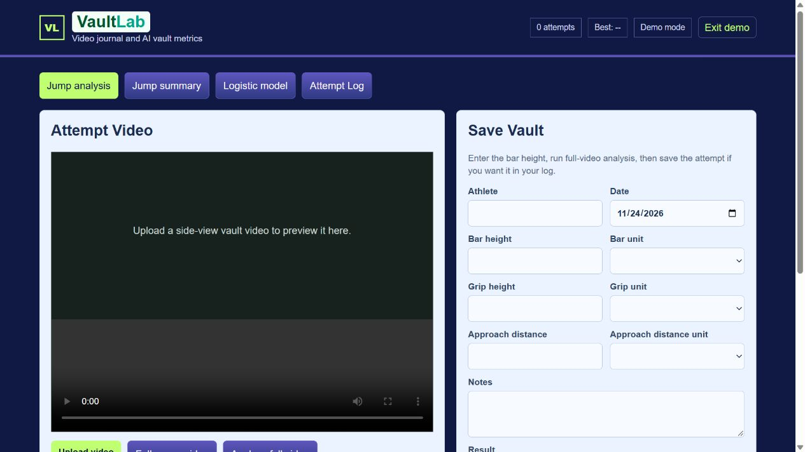

# VaultLab

**A closer look at every vault.**

VaultLab is a browser-based video analysis app for high school pole vaulters and coaches. Upload a practice video, estimate body positions and vault phases with MediaPipe, review a logistic-regression estimate, and save the attempt for later review.

**[Try VaultLab](https://vaultlab.web.app/)** - choose **Explore the demo** to start without an account.



## What You Can Do

- **Jump analysis:** upload a side-view video, track body landmarks, and review estimated takeoff, inversion, and clearance moments.
- **Jump summary:** review speed calculations, timing, and coaching observations alongside your entered data.
- **Logistic model:** view an estimated make probability and how each input contributes to it.
- **Attempt Log:** save attempts with their videos, reload them, and export the log as CSV.

Videos and training records are stored in your browser. Google and email sign-in are available through Firebase Authentication; demo mode works without signing in.

## Run It Locally

Install **Node.js 22.12 or newer** and **pnpm 10**. Then:

```sh
git clone https://github.com/jayaxu091-blip/PV-analysis.git
cd PV-analysis
pnpm install --frozen-lockfile
pnpm dev
```

Open the URL printed by Vite and select **Explore the demo**. Upload your own side-view MP4 with the athlete visible throughout the attempt. Internet access is needed to load the MediaPipe runtime and pretrained model.

```sh
pnpm test      # Measurement, model, and login checks
pnpm build     # TypeScript checks and production files in dist/
pnpm preview   # Preview the production build locally
```

No Python server, private video dataset, or personal account is needed to build the website. The Python scripts are for the separate research/training workflow. If using a different Firebase project, see [development notes](docs/development.md).

## Find the Code

| Start here | Responsibility |
| --- | --- |
| [src/poseAnalysis.ts](src/poseAnalysis.ts) | Samples video frames and runs MediaPipe Pose Landmarker Lite. |
| [src/studyMeasurements.ts](src/studyMeasurements.ts) | Converts landmarks into angles and estimated vault phases. |
| [src/restoredStudyBridge.ts](src/restoredStudyBridge.ts) | Preserves full-precision measurements while the interface displays rounded values. |
| [src/vaultModel.ts](src/vaultModel.ts) | Readable model parameters, probability calculation, and factor explanations. |
| [tools/train_pose_logistic_model.py](tools/train_pose_logistic_model.py) | Trains the pose-feature logistic-regression models. |
| [src/videoStore.ts](src/videoStore.ts) | Saves video blobs in IndexedDB. |
| [tools/templates/login-screen.tsx](tools/templates/login-screen.tsx) | Current production login interface. |
| [tools/separate_original_pages.mjs](tools/separate_original_pages.mjs) | Builds the four-page production navigation from the preserved interface. |

The production site is built from `restored-app/`, using a preserved interface connected to the readable TypeScript analysis modules. `src/main.tsx` is an alternate readable React interface, not the production entrypoint. [Architecture](docs/architecture.md) explains the full path so contributors know which files to edit.

## Repository Guide

| Folder | Contents |
| --- | --- |
| [src/](src/) | Analysis, model, browser storage, styles, and readable interface source. |
| [restored-app/](restored-app/README.md) | Required preserved production interface assets. |
| [tests/](tests/) | Automated tests and the shared study fixture. |
| [tools/](tools/README.md) | Build helpers, extraction tools, and model-training scripts. |
| [model_output/](model_output/README.md) | Study model parameters and extracted feature data. |
| [docs/](docs/development.md) | Architecture, setup instructions, and screenshots. |

Local papers, competition submissions, raw videos, exports, temporary dependencies, and video-editing scripts are excluded from GitHub. They are not needed to run the app.

## Research Scope

The active study model uses four inputs: bar height, takeoff body-line angle, inversion alignment, and the estimated takeoff-to-clearance interval. It was fitted to a balanced 30-attempt dataset. Saving more attempts does not retrain the active model.

These are single-camera estimates. Body-line angle is not center-of-mass launch angle, and the clearance frame is a proxy. Predictive accuracy on new athletes has not been established; results should support athlete-coach review rather than act as a technique grade.

MediaPipe provides the pretrained pose model. VaultLab combines it with vault-specific calculations, interface and storage code, and logistic-regression analysis. React, Firebase, and other third-party components retain their own licenses; see [NOTICE](NOTICE).

## License

Original project code is released under the [MIT License](LICENSE). Before proposing a change, run `pnpm test` and `pnpm build`.
